# Liquid d1 vs a same-size chat LLM: 800 real decisions

I tested **Liquid AI's d1-3B "decision model"** (open weights, released Oct 2026) against **Qwen2.5-3B-Instruct** (a general chat model of the same size) and a classic **TF-IDF + logistic regression** baseline on four everyday decision tasks. Everything ran locally on an 8-thread CPU, 4-bit quantized, with every call logged. Speed was then re-measured on a Colab T4 GPU (spam and routing).

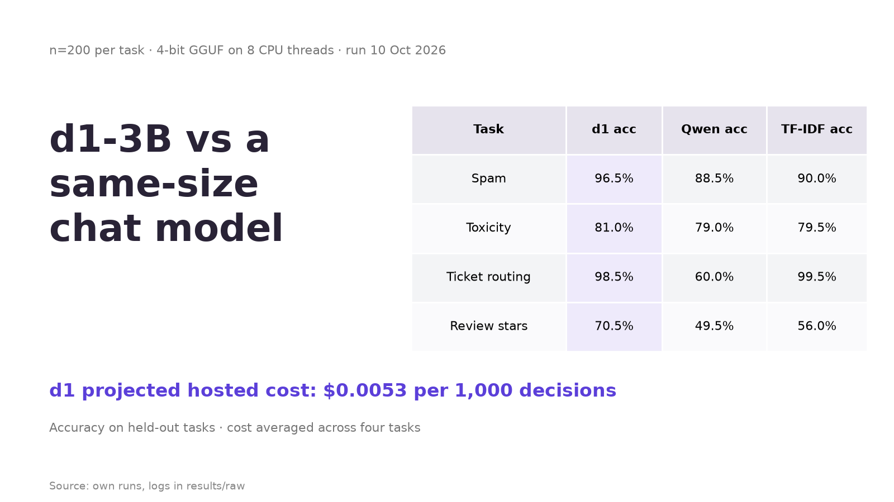

## TL;DR

| Task (200 held-out items each) | d1-3B | Qwen2.5-3B | TF-IDF + LR (trained) |
|---|---|---|---|
| Spam | **96.5%** | 88.5% | 90.0% |
| Toxicity | 81.0% | 79.0% | 79.5% |
| Ticket routing | 98.5% | 60.0% (85.5% with team-name prompt) | **99.5%** |
| Review stars (1-5) | **70.5%** (97% within 1 star) | 49.5% | 56.0% |

- **Accuracy:** d1 clearly beats the same-size chat model on 3 of 4 tasks (95% bootstrap CIs don't overlap) and ties on toxicity. d1 and Qwen got zero training examples; TF-IDF was trained on each dataset.
- **Calibration:** d1's probabilities are honest. Spam ECE 0.014 vs Qwen 0.130 (5-bin ECE on P(spam), as in the calibration chart; `summary.csv` reports a different, top-label ECE); decisions with p<0.2 or p>0.8 (96% of them) were 97.4% correct.
- **Latency (CPU):** no speed win on a laptop-class CPU (see GPU below for the opposite result). Median d1 vs Qwen: 256 vs 207 ms (spam), 257 vs 284 ms (toxicity), 481 vs 307 ms (routing), 573 vs 991 ms (stars). Five questions in one call cost 2.6x one question, not 5x.
- **Cost (projection, not a bill):** at Liquid's list price ($0.04 / 1M input tokens) about **$0.003-0.009 per 1,000 decisions**: ~64-145x cheaper than frontier chat models, but only ~3.5x cheaper than budget chat models.
- **GPU (Colab T4):** on a GPU the picture flips: d1 was **1.75-2x faster** than Qwen at one request at a time (p50 35 vs 72 ms spam, 78 vs 137 ms routing). Details below.
- **Not tested yet:** Liquid's hosted API (no key).

### GPU (Colab T4)

Same 4-bit GGUFs on a Colab Tesla T4, llama.cpp b11541 `llama-server`, all layers on the GPU (checked by GPU memory), flash attention on, prompt cache off. Two repetitions with alternating model order: 200 + 100 items per task, so latency/throughput rows pool n=300. Zero HTTP errors, parse rate 1.0 everywhere. Raw file: [`results/gpu_t4/d1_gpu_speed_results.json`](results/gpu_t4/d1_gpu_speed_results.json) (protocol in [`colab/README.md`](colab/README.md)).

| One request at a time (c=1) | d1-3B | Qwen2.5-3B | CPU p50, d1 / Qwen |
|---|---|---|---|
| Spam p50 / p95 | **35 / 47 ms** | 72 / 91 ms | 256 / 207 ms |
| Routing p50 / p95 | **78 / 85 ms** | 137 / 151 ms | 481 / 307 ms |
| Spam requests/s | **27.0** | 13.4 | |
| Routing requests/s | **12.6** | 7.2 | |
| Spam accuracy (rep 1, n=200) | **96.5%** | 92.0% | |
| Routing accuracy (rep 1, n=200) | **98.5%** | 63.5% (letter prompt) | |

- **Speed:** d1 was 2.0x faster on spam and 1.75x on routing (p50). Versus my CPU run, d1 got 6-7x faster on the GPU and Qwen 2-3x. This is end-to-end HTTP latency, not architecture efficiency: d1's prompts are also shorter (69 vs 90 tokens on spam, 174 vs 224 on routing) and Qwen generates up to 4 tokens while d1 does one forward pass.
- **Accuracy** matches the CPU run for d1 (96.5% / 98.5%). Qwen moved a few points vs CPU (spam 88.5% -> 92.0%, routing 60.0% -> 63.5%), presumably GPU vs CPU numeric differences flipping close calls.
- **Several questions per request (d1, c=1, 30 routing items):** k = 1/2/3/5 questions took p50 81/105/138/192 ms, i.e. 12.4/18.8/21.5/25.9 decisions/s. Five questions cost 2.4x one question and roughly doubled decisions/s.
- **Concurrency 4 gave no throughput gain for either model.** With `-np 4` and 4 requests in flight, requests/s stayed flat (d1 routing 12.6 -> 12.0, d1 spam 25.7 -> 23.6 in rep 2, Qwen spam 13.4 -> 14.3, Qwen routing 7.2 -> 7.5) while p50 latency rose 4-4.7x. The first four requests of each c=4 batch mostly finished at the same moment, so the server did batch them; the batch just took about as long as running them one by one. My best explanation: these requests are almost all prompt processing (prefill), which is compute-bound and already keeps the T4 busy at one request, so batching only queues. Not proven; the run didn't capture GPU utilization or server timings. See [issues-found/005](issues-found/005-gpu-concurrency-no-throughput-gain.md).
- **Outlier:** in rep 1, the first four d1 spam requests at concurrency 4 each took ~13.1 s (max 13,150 ms), all finishing together, after warmup had already run. Likely a one-time CUDA kernel JIT compile (the prebuilt build has no native T4 code) for a batch shape the warmup didn't hit; it didn't recur in rep 2. It drags the pooled d1 spam c=4 throughput down to 11.9 req/s, so I quote rep 2 (23.6 req/s) above. c=1 numbers are unaffected.

## Charts

| | |
|---|---|
| 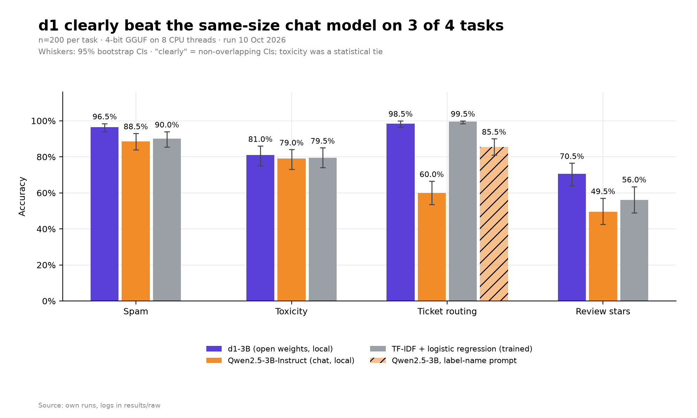 | 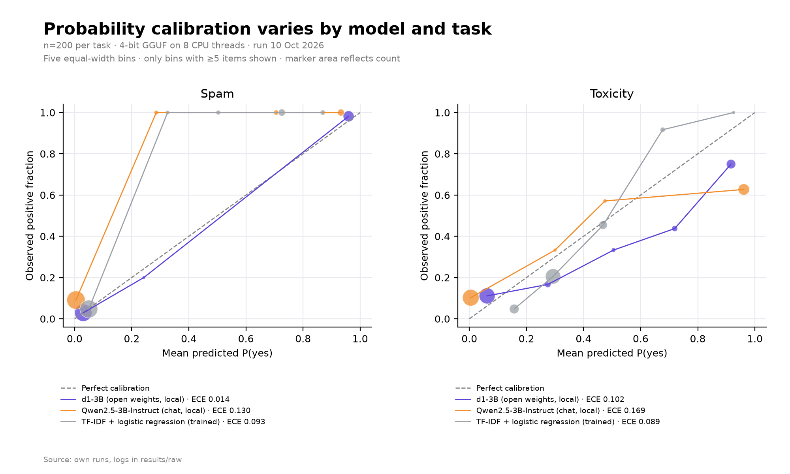 |
| 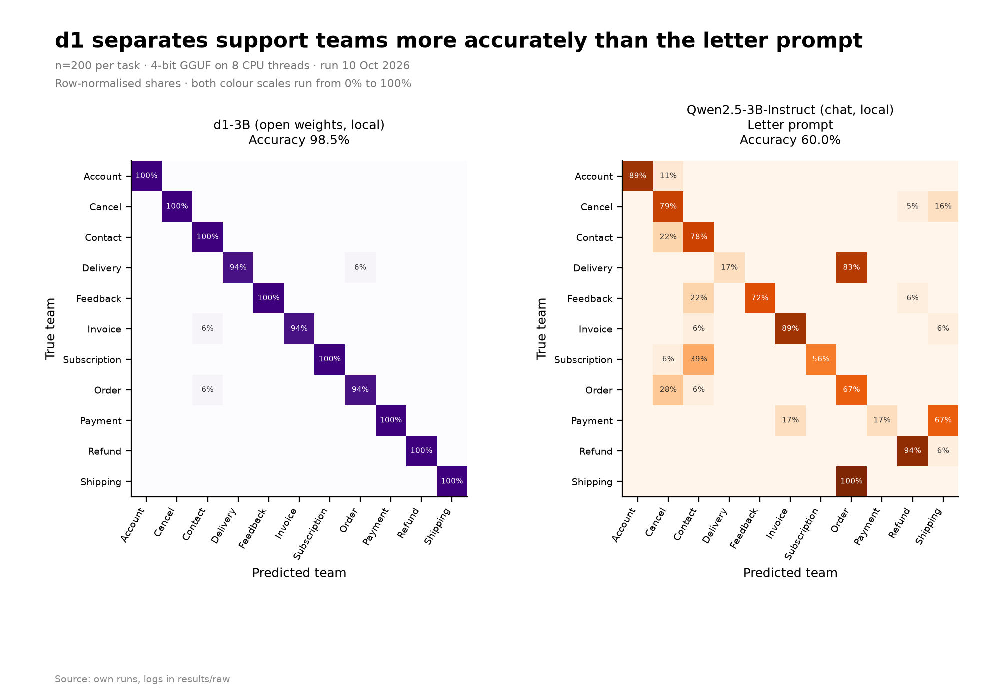 | 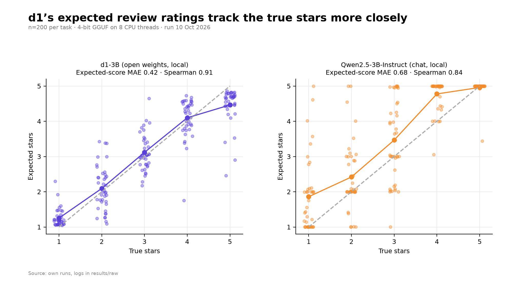 |
| 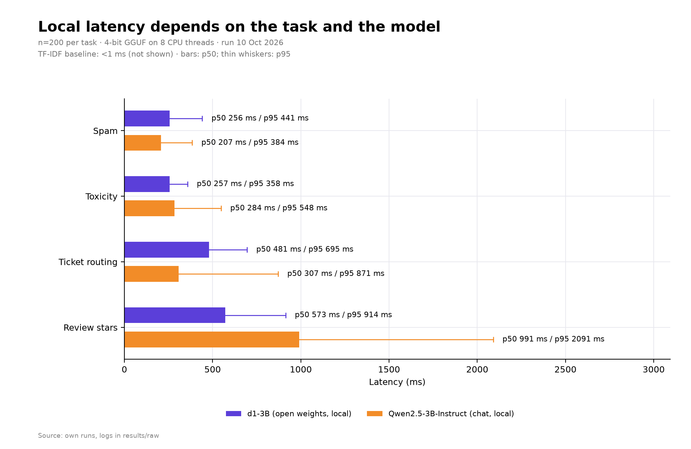 | 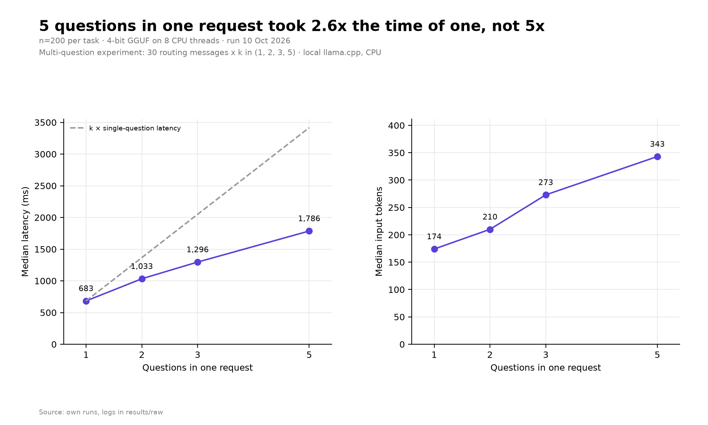 |
| 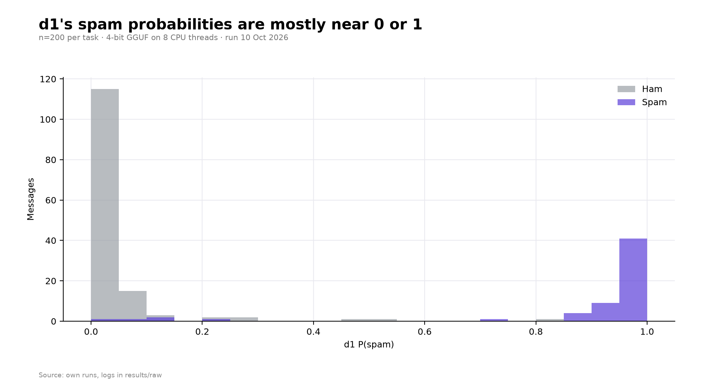 | 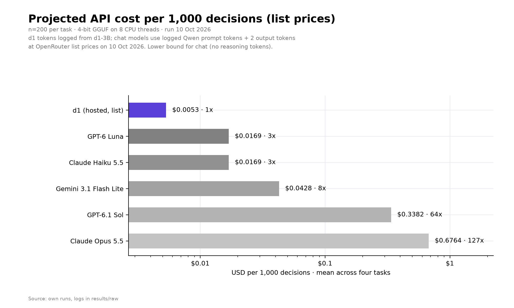 |
| 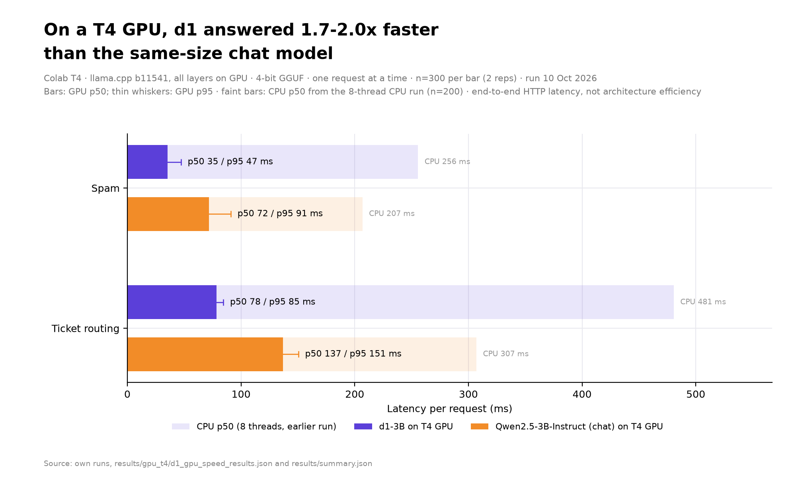 | 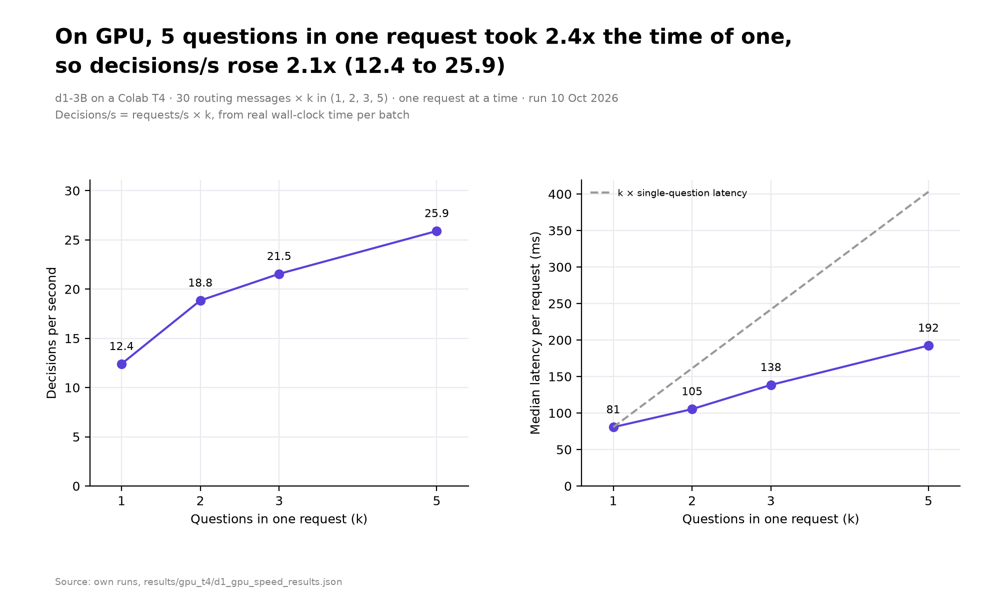 |

## Repo layout

- `harness/` - data prep, model clients (d1 local/hosted, Qwen, TF-IDF), runner, charts, cost projection, tests
- `data/` - the exact 200-item eval sets and training splits (from public datasets)
- `results/` - `summary.csv/json`, `per_item.csv`, `cost_projection.csv`, and `raw/` with every model call; `gpu_t4/` holds the Colab T4 results JSON
- `images/` - charts and terminal screenshots
- `colab/` - GPU speed-test assets (`harness/gpu_charts.py` draws the GPU charts)
- `PENDING_HOSTED.md` - how to run against Liquid's hosted API

## Honest caveats

- One run, 200 items per task, 4-bit quantized models on CPU. Your numbers will differ.
- GPU numbers are one Colab T4 session (2 reps), spam and routing only, measured end to end through llama-server.
- Qwen is scored from its answer's token probabilities; a letter-option prompt hurt it on routing, so a fairer team-name prompt is reported too.
- Chat-model cost projections reuse Qwen token counts and ignore reasoning tokens, so they are a lower bound.
- d1 weights are under Liquid's LFM Open License; check it before commercial use.

## Reproduce

A sequential CPU evaluation harness comparing Liquid d1-3B, Qwen2.5-3B-Instruct and a TF-IDF/logistic-regression baseline on spam, offensive tweets, customer routing and review ratings. Both local neural models use Q4_K_M quantization. Hosted clients are implemented but are not needed for local experiments.

## Setup

Use Python 3.13 (`python3` on this machine). No torch is required.

```bash
python3 -m pip install datasets scikit-learn pandas numpy requests matplotlib pillow
```

If your system Python requires it, add `--break-system-packages`, or use a virtual environment. Dependencies are already installed in the supplied environment.

Download [llama.cpp b11541](https://github.com/ggml-org/llama.cpp/releases/tag/b11541) and the official [Liquid d1 GGUF](https://huggingface.co/LiquidAI/d1-3B-GGUF/tree/main) and [Qwen GGUF](https://huggingface.co/Qwen/Qwen2.5-3B-Instruct-GGUF/tree/main):

```bash
mkdir -p vendor/llama models
curl -L --fail https://github.com/ggml-org/llama.cpp/releases/download/b11541/llama-b11541-bin-ubuntu-x64.tar.gz -o /tmp/llama-b11541.tar.gz
tar -xzf /tmp/llama-b11541.tar.gz -C vendor/llama --strip-components=1
curl -L --fail https://huggingface.co/LiquidAI/d1-3B-GGUF/resolve/main/d1-3B-Q4_K_M.gguf -o models/d1-3B-Q4_K_M.gguf
curl -L --fail https://huggingface.co/Qwen/Qwen2.5-3B-Instruct-GGUF/resolve/main/qwen2.5-3b-instruct-q4_k_m.gguf -o models/qwen2.5-3b-instruct-q4_k_m.gguf
```

Launch each server in a separate terminal (adjust binary location if using a different release archive):

```bash
vendor/llama/llama-server -m models/d1-3B-Q4_K_M.gguf --host 127.0.0.1 --port 8081 -t 8 -tb 8 -ngl 0 -np 1 -c 4096
vendor/llama/llama-server -m models/qwen2.5-3b-instruct-q4_k_m.gguf --host 127.0.0.1 --port 8082 -t 8 -tb 8 -ngl 0 -np 1 -c 4096
```

These servers are already running in the supplied environment. The d1 server exposes `/v1/systemone`; Qwen exposes `/v1/chat/completions`.

## Prepare and run

Commands work from the repository root. Data preparation defaults to offline Hugging Face cache use. For the initial download on a new machine, use `HF_HUB_OFFLINE=0 python3 harness/prepare_data.py`.

```bash
python3 harness/prepare_data.py
python3 harness/run.py --model d1-local --task spam --limit 3
python3 harness/run.py --model d1-local --all --limit 3
python3 harness/run.py --model qwen-local --all --limit 3
OPENBLAS_NUM_THREADS=8 OMP_NUM_THREADS=8 python3 harness/run.py --model tfidf-lr --all --limit 3
```

`--all` means all four tasks for the selected model. Omit `--limit` for 200 decisions per task. Do not run separate model commands concurrently when measuring CPU latency. TF-IDF fitting is excluded from latency; each prediction is timed individually.

Data selection uses NumPy seed 42 and source split/index IDs. Each evaluation file has 200 rows. Spam has 60 spam/140 ham, with all other source rows for training. Offensive tweets use the test split's rounded natural ratio (56/144 in the cached revision), with the original training split. Routing balances the 11 actual categories at 18–19 each, uses 3,000 other rows for training, and replaces placeholders consistently. The actual dataset label is `SUBSCRIPTION`, not `NEWSLETTER`. Rating has 40 reviews per star and 5,000 randomly selected training reviews. Review text is truncated to at most 1,000 characters including an ellipsis. Train/eval source rows are disjoint; naturally duplicated text in source datasets is not deduplicated. For exact replication, keep the same HF dataset cache/revision and package versions.

Every attempt, including failures, retries and one warmup per active task invocation, is appended to `results/raw/<model>__<task>.jsonl`. Model IDs containing `/` are sanitized for filenames; the original model ID stays in each record. Successful evaluation IDs are skipped on resume; warmups never count as completed evaluation IDs. `--limit 3` always selects the first three dataset rows, even when resuming. HTTP timeout is 300 seconds, with up to three retries after transient errors. HTTP latency excludes parsing and backoff. `valid` requires a valid parsed chat answer and usable option mass; `text_valid`, `parsed_answer`, `invalid`, and `text_only_fallback` retain diagnostics. Predictions use distribution argmax for every model, including rating.

Chat probabilities use only the first generated token's top logprobs, merging case/whitespace variants and renormalizing over answer options. Missing options get zero; zero total mass becomes uniform and invalid. Full response text must itself be an answer token. Hosted chat may fall back to a one-hot parsed answer if logprobs are unavailable, and flags this so it can be distinguished from calibrated probabilities.

```bash
python3 harness/multiq.py                 # 30 routing items × k=1,2,3,5, plus warmup
python3 harness/multiq.py --limit 1       # optional local plumbing check
python3 harness/analyze.py
python3 harness/charts.py
python3 harness/render_terminal.py results/summary.txt images/terminal.png --title 'd1 results'
cat results/summary.txt | python3 harness/render_terminal.py - images/terminal-stdin.png
```

Multi-question order is shuffled per item with seed 42 and resumes by `(id,k)`. The questions are team, complaint, urgency, refund intent and anger, added in that order. Analysis excludes warmups and uses the last successful record for each ID; `n_errors` counts failed non-warmup attempts, not unique failed items. Invalid successes remain in metrics. Macro F1 includes every task class. ECE uses ten equal-width bins; binary ECE uses P(positive), multiclass ECE uses top-class confidence. Undefined AUC/Spearman is null. Accuracy intervals use 1,000 bootstrap resamples, seed 0.

Rating's primary accuracy, within-one accuracy and MAE use argmax. The report also includes the corresponding metrics for expected score rounded half-up, continuous expected-score MAE, and Spearman between true and expected score. Labels and expected scores are stored 0–4; plotted stars are 1–5.

Analysis writes `results/summary.csv`, `summary.json`, `summary.txt` and `per_item.csv`. Charts use available raw data and annotate actual sample counts for partial runs. They write 200-dpi PNGs under `images/`. Empty input produces empty summaries and no charts. Existing image files are not automatically deleted.

Smoke runs are plumbing checks, not meaningful accuracy estimates. Before the real run, delete the smoke raw logs and any smoke charts, then regenerate empty summaries:

```bash
rm -f results/raw/*.jsonl
python3 harness/analyze.py
python3 harness/charts.py
```

## Hosted models (optional; paid)

Local commands never call hosted endpoints. Missing API keys cause a clear skip. To run hosted models later, set a key yourself and explicitly select the hosted model:

```bash
export LIQUID_API_KEY='...'
python3 harness/run.py --model d1-hosted --task spam --limit 3 --max-calls 4
# Optional: export LIQUID_MODEL='d1:free'
export OPENROUTER_API_KEY='...'
python3 harness/run.py --model openrouter-d1 --task spam --limit 3 --max-calls 4
# First populate CHAT_PRICES in harness/prices.py with verified USD/M token rates:
python3 harness/run.py --model openrouter:provider/model --task spam --limit 3 --max-calls 4
```

Hosted chat refuses to run with unknown prices. Every request, including warmups/retries and logprob fallback requests, counts toward `--max-calls` (default 1,000 per invocation, shared across tasks). A conservative cost reserve is checked **before** each paid call and added to the running estimate; it uses serialized UTF-8 request bytes plus 4,096 tokens of framing allowance, and the maximum output token count. Logged charges use the greater of this reserve, token-based cost and returned `usage.cost`, including failed attempts. Prior logged charges for the model carry across invocations. `MAX_USD` defaults to 2; a request is refused if its estimated spend would cross the cap. This is an estimate based on configured rates, not a provider billing guarantee. Do not delete hosted logs if relying on accumulated spend tracking.

The separate report projection uses observed mean tokens: d1 at the spec's $0.04/M input tokens, assuming comparable local/hosted tokenizer families. It is **not** an observed invoice. Chat projections appear only when `CHAT_PRICES` has that model's rates; that dict is empty by default.

Base URL overrides: `D1_LOCAL_BASE_URL`, `QWEN_LOCAL_BASE_URL`, `LIQUID_BASE_URL`, `OPENROUTER_BASE_URL`. Defaults are in `harness/models.py`; include any provider path prefix, with an optional trailing `/v1`. Add a fixed endpoint via one `REGISTRY` entry. All `openrouter:<model_id>` IDs work without registry edits.

## Files and checks

- `harness/tasks.py`, `prepare_data.py`: shared prompts/criteria and deterministic data preparation.
- `harness/models.py`, `run.py`, `multiq.py`: clients, TF-IDF baseline, logging, budget guards and experiments.
- `harness/analyze.py`, `prices.py`, `charts.py`, `render_terminal.py`: metrics, projections and presentation.
- `harness/common.py`: paths and JSONL helpers.
- `harness/test_harness.py`: offline checks of parsing, metrics, retry logging and spending guards.

```bash
python3 -m unittest discover -s harness -p 'test_*.py' -v
```


---
Written up on the *Tech in General* Substack: https://nandigamharikrishna.substack.com
